# Entity-Relationship (ER) Diagram & Data Dictionary

## Course Registration & Academic Management System
**Advanced Database Management Systems (ADBMS) Project**

---

## 1. High-Level Architecture Overview

The system is designed around a strictly normalized relational schema running on **PostgreSQL 15+**. The architecture separates authentication credentials (`users`) from domain profile entities (`students`, `faculty`), isolates semester-independent catalog specifications (`courses`) from term-specific scheduling instances (`course_offerings`), and guarantees registration atomicity through ACID-compliant transactional tables (`enrollments`, `waitlist_entries`, `registration_audit_logs`).

---

## 2. Mermaid Entity-Relationship Diagram

```mermaid
erDiagram
    USERS ||--o| STUDENTS : "has profile (1:1)"
    USERS ||--o| FACULTY : "has profile (1:1)"
    USERS ||--o{ REGISTRATION_AUDIT_LOGS : "acts as (1:N)"
    USERS ||--o{ NOTIFICATIONS : "receives (1:N)"

    DEPARTMENTS ||--o{ STUDENTS : "belongs to (1:N)"
    DEPARTMENTS ||--o{ FACULTY : "employed by (1:N)"
    DEPARTMENTS ||--o{ COURSES : "offers (1:N)"

    ACADEMIC_TERMS ||--o{ REGISTRATION_PERIODS : "schedules (1:N)"
    ACADEMIC_TERMS ||--o{ COURSE_OFFERINGS : "holds (1:N)"
    ACADEMIC_TERMS ||--o{ COMPLETED_COURSES : "graded in (1:N)"

    COURSES ||--o{ COURSE_PREREQUISITES : "requires (1:N)"
    COURSES ||--o{ COURSE_PREREQUISITES : "is prerequisite for (1:N)"
    COURSES ||--o{ COURSE_OFFERINGS : "instantiated as (1:N)"
    COURSES ||--o{ COMPLETED_COURSES : "recorded as (1:N)"

    FACULTY ||--o{ COURSE_OFFERINGS : "teaches (1:N)"

    COURSE_OFFERINGS ||--o{ COURSE_SCHEDULES : "meets at (1:N)"
    COURSE_OFFERINGS ||--o{ ENROLLMENTS : "has registrations (1:N)"
    COURSE_OFFERINGS ||--o{ WAITLIST_ENTRIES : "has waitlist (1:N)"
    COURSE_OFFERINGS ||--o{ REGISTRATION_AUDIT_LOGS : "logs events for (1:N)"

    STUDENTS ||--o{ ENROLLMENTS : "registers (1:N)"
    STUDENTS ||--o{ WAITLIST_ENTRIES : "waits for (1:N)"
    STUDENTS ||--o{ COMPLETED_COURSES : "has transcript (1:N)"
    STUDENTS ||--o{ REGISTRATION_AUDIT_LOGS : "subject of (1:N)"

    USERS {
        int id PK
        varchar email UK
        varchar password_hash
        varchar role "student | faculty | admin"
        boolean is_active
        timestamptz created_at
        timestamptz updated_at
        timestamptz last_login
    }

    DEPARTMENTS {
        int id PK
        varchar code UK "e.g. CS, EE"
        varchar name UK
        text description
        varchar head_name
        boolean is_active
        timestamptz created_at
    }

    STUDENTS {
        int id PK
        int user_id FK,UK
        varchar student_id UK "e.g. STU2024001"
        varchar first_name
        varchar last_name
        date date_of_birth
        varchar gender
        varchar phone
        text address
        int department_id FK
        int enrollment_year
        int current_year "1 to 6"
        numeric gpa "0.00 to 4.00"
        int max_credits "default 18"
        boolean is_active
        timestamptz created_at
        timestamptz updated_at
    }

    FACULTY {
        int id PK
        int user_id FK,UK
        varchar faculty_id UK "e.g. FAC001"
        varchar first_name
        varchar last_name
        int department_id FK
        varchar designation
        varchar phone
        varchar office
        text specialization
        boolean is_active
        timestamptz created_at
        timestamptz updated_at
    }

    ACADEMIC_TERMS {
        int id PK
        varchar name UK "e.g. Fall 2026"
        varchar term_code UK "e.g. FA2026"
        date start_date
        date end_date
        boolean is_current
        boolean is_active
        timestamptz created_at
    }

    REGISTRATION_PERIODS {
        int id PK
        int term_id FK
        varchar name
        timestamptz start_datetime
        timestamptz end_datetime
        int_array eligible_years "{1,2,3,4}"
        boolean is_active
        timestamptz created_at
    }

    COURSES {
        int id PK
        varchar code UK "e.g. CS301"
        varchar name
        text description
        int department_id FK
        int credits "1 to 6"
        int course_level "100 to 600"
        varchar category "core | elective | lab"
        boolean is_active
        timestamptz created_at
        timestamptz updated_at
    }

    COURSE_PREREQUISITES {
        int course_id PK,FK
        int prerequisite_id PK,FK
        boolean is_mandatory
    }

    COURSE_OFFERINGS {
        int id PK
        int course_id FK
        int term_id FK
        int faculty_id FK
        varchar section "e.g. A, B"
        varchar room
        int capacity
        int enrolled_count
        int waitlist_count
        varchar status "open | closed | cancelled | completed"
        boolean is_active
        timestamptz created_at
        timestamptz updated_at
    }

    COURSE_SCHEDULES {
        int id PK
        int offering_id FK
        varchar day_of_week "monday to sunday"
        time start_time
        time end_time
        varchar room
    }

    ENROLLMENTS {
        int id PK
        int student_id FK
        int offering_id FK
        varchar status "registered | dropped | completed | failed | withdrawn"
        varchar grade "A+, A, B, C, D, F, W, I"
        timestamptz registered_at
        timestamptz dropped_at
        text drop_reason
        timestamptz updated_at
    }

    WAITLIST_ENTRIES {
        int id PK
        int student_id FK
        int offering_id FK
        int position
        varchar status "waiting | promoted | withdrawn | expired"
        timestamptz joined_at
        timestamptz promoted_at
        timestamptz withdrawn_at
    }

    COMPLETED_COURSES {
        int id PK
        int student_id FK
        int course_id FK
        int term_id FK
        varchar grade
        int credits_earned
        date completed_at
    }

    REGISTRATION_AUDIT_LOGS {
        int id PK
        int actor_user_id FK
        int student_id FK
        int offering_id FK
        varchar action "register | drop | waitlist_join | waitlist_promote"
        varchar status "success | failure"
        jsonb details
        varchar ip_address
        timestamptz created_at
    }

    NOTIFICATIONS {
        int id PK
        int user_id FK
        varchar title
        text message
        varchar type "info | success | warning | error"
        boolean is_read
        int related_id
        varchar related_type
        timestamptz created_at
    }
```

---

## 3. Detailed Data Dictionary

### 1. `users` Table
Stores primary identity and authentication credentials.
- **`id`**: Primary Key, auto-incrementing serial integer.
- **`email`**: Unique institutional email address, indexed for fast credential authentication.
- **`password_hash`**: Bcrypt hash string with cryptographic salt.
- **`role`**: Check constraint `('student', 'faculty', 'admin')`.
- **`is_active`**: Boolean flag supporting soft deactivation.

### 2. `students` Table
Stores student academic profile data.
- **`user_id`**: Foreign Key to `users(id)` with `ON DELETE CASCADE`. Unique constraint enforces 1:1 relationship.
- **`student_id`**: University-assigned matriculation code (e.g. `STU2024001`).
- **`current_year`**: Integer between 1 and 6.
- **`max_credits`**: Maximum registered credits allowed in any single term (defaults to 18).

### 3. `faculty` Table
Stores professor and teaching assistant directory details.
- **`user_id`**: Foreign Key to `users(id)` (1:1).
- **`faculty_id`**: Unique faculty employee code.
- **`department_id`**: Foreign Key to `departments(id)`.

### 4. `courses` Table
Master course catalog definitions.
- **`code`**: Unique academic code (e.g., `CS301`).
- **`credits`**: Check constraint `(credits BETWEEN 1 AND 6)`.
- **`course_level`**: Standard academic tier (100, 200, 300, 400, 500, 600).

### 5. `course_prerequisites` Table
Junction table modeling a self-referencing Many-to-Many directed graph of course dependencies.
- **Composite Primary Key**: `(course_id, prerequisite_id)`.
- **Check Constraint**: `course_id <> prerequisite_id` prevents trivial self-cycles.

### 6. `course_offerings` Table
Concrete section instance of a course offered in a particular semester.
- **Unique Constraint**: `(course_id, term_id, section)`.
- **`enrolled_count`** & **`capacity`**: Check constraint `enrolled_count <= capacity` enforced alongside concurrency locking.

### 7. `course_schedules` Table
Classroom meeting slots. Multiple rows per offering allow for split weekly schedules (e.g., Mon/Wed 10:00-11:30).
- **Check Constraint**: `end_time > start_time`.

### 8. `enrollments` Table
Transactional registration tracking.
- **Unique Constraint**: `(student_id, offering_id)` prevents accidental double registrations.
- **Soft Drop Pattern**: When a course is dropped, the record status changes to `'dropped'` and `dropped_at` is timestamped. Records are never deleted to preserve historical transcript and billing integrity.

### 9. `waitlist_entries` Table
First-Come First-Served queue for oversubscribed sections.
- **Unique Constraint**: `(student_id, offering_id)` prevents multiple waitlist positions for the same student.
- **`position`**: Positive integer determining strict queue priority.

---

## 4. Referential Integrity Matrix

| Parent Table | Child Table | Foreign Key Column | On Delete Action | On Update Action |
| :--- | :--- | :--- | :--- | :--- |
| `users` | `students` | `user_id` | `CASCADE` | `CASCADE` |
| `users` | `faculty` | `user_id` | `CASCADE` | `CASCADE` |
| `departments` | `students` | `department_id` | `SET NULL` | `CASCADE` |
| `departments` | `courses` | `department_id` | `RESTRICT` | `CASCADE` |
| `courses` | `course_offerings` | `course_id` | `RESTRICT` | `CASCADE` |
| `academic_terms` | `course_offerings` | `term_id` | `RESTRICT` | `CASCADE` |
| `faculty` | `course_offerings` | `faculty_id` | `SET NULL` | `CASCADE` |
| `course_offerings` | `course_schedules` | `offering_id` | `CASCADE` | `CASCADE` |
| `students` | `enrollments` | `student_id` | `RESTRICT` | `CASCADE` |
| `course_offerings` | `enrollments` | `offering_id` | `RESTRICT` | `CASCADE` |
| `students` | `waitlist_entries` | `student_id` | `CASCADE` | `CASCADE` |
| `course_offerings` | `waitlist_entries` | `offering_id` | `CASCADE` | `CASCADE` |

